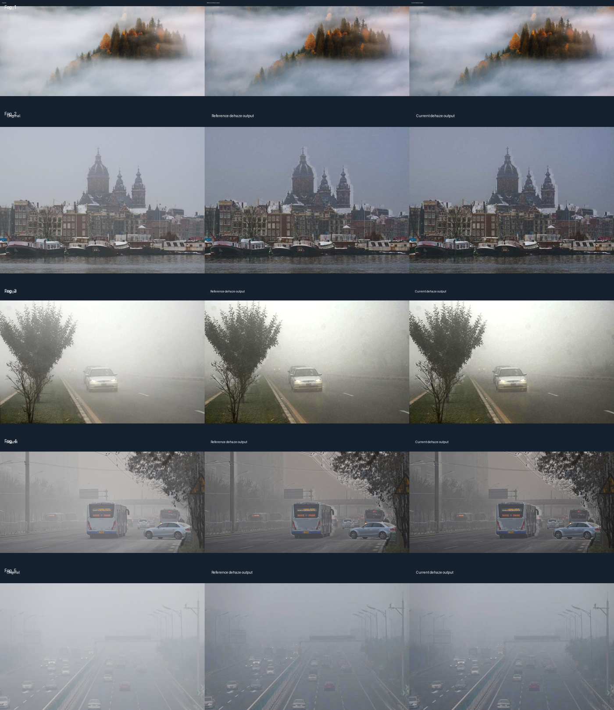

# 实时去雾效果与 RTL 仿真

当前去雾实现采用流式暗通道近似和 affine DSP 恢复，增益混合系数为 `40/64`，上限为 `48/64`。它在雾天场景中提升建筑、道路和树木的局部层次，同时保持实时视频吞吐。

## 对比图

每张图从左到右为原图、参考去雾输出、当前去雾输出。

- [Fog_1 对比](Fog_1/Fog_1_comparison.png)
- [Fog_2 对比](Fog_2/Fog_2_comparison.png)
- [Fog_3 对比](Fog_3/Fog_3_comparison.png)
- [Fog_4 对比](Fog_4/Fog_4_comparison.png)
- [Fog_5 对比](Fog_5/Fog_5_comparison.png)

## 仿真结果

五张图均由当前 `dehaze_stream_96.v` 经 Vivado XSim 2019.2 生成。每张图都检查了原图旁路、有效/帧首/行末标志和逐通道参考一致性；`reference_mismatches=0`，`bypass_exact=true`。宽度不能整除 4 的图片只在右侧复制边界像素，输出再裁回原尺寸。

复现时可按图片分别调用 `sim/run_dehaze_image_v4_clean.ps1`，它为每个输入使用独立的 XSim 构建目录，避免不同宽度图片共用仿真缓存。

模块保持 4 像素/拍、11 级流水线、两行暗通道缓存和 6 个打包恢复 DSP，适合 1280×720 实时视频。提交或下载前仍需用当前源码完成完整 TD 综合、布局布线、时序和 bitgen；离线 XSim 结果不能替代板级验证。
